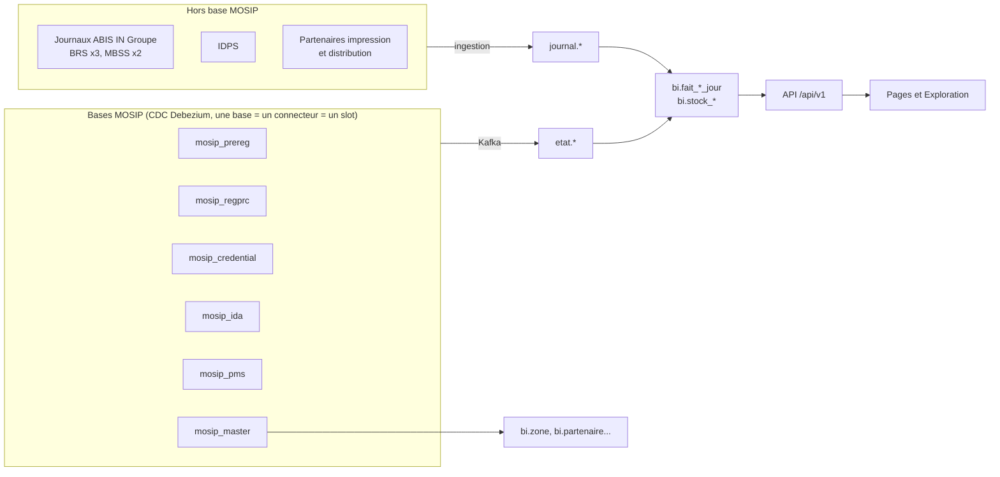

# Structure du Data Mart

Proposition du 16/10/2026, **à valider** (décisions ouvertes au § 9) avant d'écrire les migrations, l'API et les pages.
Fait référence pour les agents `data-engineer`, `dev-backend`, `dev-front` et `qa-testeur`.

Chaque table et colonne MOSIP citée vient d'un DDL officiel v1.1.5 copié dans `pipeline/sources/ddl/<base>/` (en-tête :
dépôt, tag, date). Rien n'est inventé ; l'instance réelle peut différer après mise à jour : à confirmer par un `\d+`
sur une réplique (script d'inventaire du skill `mosip-bi-pipeline`). Les codes de statut ne sont jamais listés de mémoire :
ils se relèvent sur l'instance et se font valider (tables de correspondance, § 3).

## Sommaire
1. Principes
2. Vue d'ensemble
3. Dimensions et correspondances communes
4. Sources capturées par base MOSIP
5. Domaines : pré-inscription, enrôlement, cartes, ABIS, IDPS, authentifications, vue d'ensemble et exploration
6. Fraîcheur et contrôles
7. Indicateurs → tables
8. Lots de mise en œuvre
9. Décisions à prendre

## 1. Principes

| Schéma | Contenu | Écrit par | Lu par |
|---|---|---|---|
| `etat` | Miroir de l'état courant des tables MOSIP capturées : colonnes retenues seulement, identifiants remplacés par une empreinte HMAC, `_lsn`, `_supprime`, `_source_ts` | jobs de streaming | jobs, contrôles |
| `journal` | Événements issus de sources hors base MOSIP (journaux ABIS d'IN Groupe, IDPS, partenaires d'impression et de distribution), une ligne par événement, dédoublonnée | jobs d'ingestion | jobs, contrôles |
| `pipeline` | Registre des lots, rejets, contrôles qualité, tables de correspondance validées par l'ANID et l'équipe MOSIP | jobs ; correspondances par migration | jobs, audit |
| `bi` | Dimensions, faits par jour, stocks datés, fraîcheur : tout ce que lit l'API | jobs (fonctions de recalcul) | API (lecture seule), outil BI |

Règles :
- **Faits recalculés depuis `etat` et `journal`**, jamais incrémentés par événement (un rejeu ne compte rien deux fois).
  Un lot recalcule les seules cases (jour, centre…) touchées, avant et après la mise à jour.
- **Flux et stocks séparés.** `bi.fait_<domaine>_jour` compte des événements datés (inscriptions reçues, cartes
  expédiées…). `bi.stock_<domaine>_courant` compte un état à l'instant (dossiers en cours, cartes à remettre),
  recalculé régulièrement ; `bi.stock_<domaine>_jour` en garde une photo par jour (jamais réécrite).
- **Grain le plus fin utile** : jour × centre (feuille de `bi.zone`) × axes du domaine. Région, préfecture…
  s'obtiennent par la hiérarchie de `bi.zone`, jamais stockées dans un fait (un rattachement qui change ne fausse pas
  l'historique : il suffit de recalculer).
- **Une même clé HMAC** pour tous les identifiants (RID, `bio_ref_id`, `prereg_id`, identifiants d'agents) : les
  jointures entre tables restent possibles sans jamais stocker la valeur.
- **Horodatages** : MOSIP enregistre en UTC sans fuseau ; le jour d'un événement est sa date UTC (Lomé est en UTC+0 ;
  règle écrite ici pour le jour où cela changerait).
- **Nommage** : `etat.<schéma MOSIP>_<table>` (ex. `etat.prereg_reg_appointment`, deux bases ont une table
  `transaction_type`) ; `etat.registration`, premier flux, garde son nom. Faits `bi.fait_<domaine>_jour`, stocks
  `bi.stock_<domaine>_courant` / `_jour`, correspondances `pipeline.correspondance_<objet>`.
- **Migrations Flyway additives** dans `backend/src/main/resources/db/migration` (V3, V4…), une par lot (§ 8).

## 2. Vue d'ensemble

## 3. Dimensions et correspondances communes

| Table | Contenu | Source | État |
|---|---|---|---|
| `bi.zone` | Territoire : région → préfecture → commune → canton → localité → centre (`niveau`, `code`, `nom`, `parent_id`) | `master.location` (niveaux via `hierarchy_level`, libellés `loc_hierarchy_list`), `master.registration_center.location_code` ; une langue de référence (décision 2) | existe (V1) ; codes provisoires en dev ; zone « Hors référentiel / Centre non référencé » (V2) |
| `bi.jour` | Calendrier : jour, semaine ISO (lundi), mois, trimestre, année, libellés français | généré par migration (2023 → 2035) | à créer |
| `bi.type_demande` | `reg_type` → libellé affiché, ordre | 8 codes de l'énumération `RegistrationType` v1.1.5 (NEW, UPDATE, RES_UPDATE, CORRECTION, ACTIVATED, DEACTIVATED, LOST, RES_REPRINT) ; libellés à valider | à créer |
| `bi.centre_info` | Attributs d'un centre : type (`cntrtyp_code` → `reg_center_type`), coordonnées (`latitude`, `longitude`), nombre de postes (`number_of_kiosks`), actif | `master.registration_center` | à créer |
| `bi.partenaire` | Partenaire : identifiant, nom de l'organisation, type, statut d'approbation, actif | `pms.partner`, `pms.partner_type` | à créer |
| Sexe, tranche d'âge | `bi.fait_niu_profil_jour` (F, H, I ; 8 tranches) ; colonnes `sexe`, `tranche_age` des autres faits (`I` / `inconnu`) | `idrepo.anonymous_profile` (1.1.5.5 et plus, décision 11 tranchée le 20/10/2026) | V4 |

Correspondances (dans `pipeline`, **vides hors développement tant qu'elles ne sont pas validées** ; un code absent
compte en « non classé » et déclenche une alerte) :

| Table | Clé source | Valeur |
|---|---|---|
| `pipeline.correspondance_statut` | `regprc.registration.status_code` | abouti, en cours, échoué, rejeté (existe, V2) |
| `pipeline.correspondance_motif_rejet` | (`trn_type_code`, `status_code`, `sub_status_code`) de `registration_transaction` | technique, superviseur, doublon, autre |
| `pipeline.correspondance_transaction` | `trn_type_code` + `status_code` de `registration_transaction` | événement métier : NIU généré, demande d'impression envoyée… |
| `pipeline.correspondance_statut_preinscription` | `prereg.applicant_demographic.status_code` | en attente, réservée, expirée, annulée (existe, V4 ; la consommation se lit dans la table `_consumed`) |
| `pipeline.correspondance_sexe` | `gender` du profil anonymisé | F, H (existe, V4) |
| `pipeline.correspondance_statut_carte` | `credential.credential_transaction.status_code` | envoyée, en attente, rejetée, échouée |
| `pipeline.correspondance_statut_auth` | `ida.auth_transaction.status_code` | réussie, échouée |
| `pipeline.seuil_qualite_bio` | modalité | bornes Excellent / Moyen / Faible (à fournir par IN Groupe) |

## 4. Sources capturées par base MOSIP

Un connecteur Debezium par base (`bi-cdc-<base>-<env>`), publication explicite créée par le DBA, `column.include.list`
limité aux colonnes « retenues ». Les clés primaires identifiantes partent en clair dans la clé Kafka (Debezium ne
masque pas les clés) : topics à accès restreint, empreinte HMAC dans Spark.

### mosip_regprc
| Table | Clé | Retenues | Exclues (raison) | Sert à |
|---|---|---|---|---|
| `registration` | `id` (RID) → HMAC | voir V2 (`etat.registration`) | `ref_reg_id`, `status_comment`, `cr_by`… | inscriptions, statuts |
| `registration_list` | `id` | `reg_id` → HMAC, `reg_type`, `status_code`, `client_status_code`, `packet_size`, `cr_dtimes`, `upd_dtimes`, `is_deleted` | `additional_info` (JSON du client), `*_comment` (texte libre), `cr_by`, `upd_by` | paquets synchronisés, « synchronisés mais non chargés » |
| `registration_transaction` | `id` | `reg_id` → HMAC, `trn_type_code`, `status_code`, `sub_status_code`, `parent_regtrn_id`, `cr_dtimes`, `upd_dtimes`, `is_deleted` | `remarks`, `status_comment` (texte libre), `ref_id` (peut contenir un RID ou un NIU) | étapes, ancienneté, bloqués, motifs de rejet, date du NIU, demandes d'impression par centre |
| `reg_manual_verification` | (`reg_id`, `matched_ref_id`, `matched_ref_type`) → HMAC des deux identifiants | `matched_ref_type`, `mv_usr_id` → HMAC, `status_code`, `reason_code`, `trntyp_code`, `is_active`, `cr_dtimes`, `upd_dtimes`, `is_deleted` | `res_text` (réponse brute), `status_comment` | adjudication côté MOSIP, rejets « superviseur » |
| `abis_request` | `id` | `request_type`, `request_dtimes`, `status_code`, `abis_app_code`, `bio_ref_id` → HMAC, `ref_regtrn_id`, `req_batch_id`, `cr_dtimes`, `upd_dtimes`, `is_deleted` | `req_text`, `status_comment` | requêtes ABIS vues par MOSIP |
| `abis_response` | `id` | `abis_req_id`, `resp_dtimes`, `status_code`, `cr_dtimes`, `is_deleted` | `resp_text`, `status_comment` | réponses, délais, erreurs |
| `abis_response_det` | (`matched_bio_ref_id`, `abis_resp_id`) → HMAC du premier | `cr_dtimes`, `is_deleted` | — | HIT / NO HIT, nombre de candidats |
| `reg_bio_ref` | `reg_id` → HMAC | `bio_ref_id` → HMAC, `is_active`, `cr_dtimes`, `is_deleted` | — | relier une requête ABIS à son RID, donc à son centre |
| `transaction_type` | (`code`, `lang_code`) | `descr`, `is_active` | — | libellés des étapes |

### mosip_prereg
| Table | Clé | Retenues | Exclues | Sert à |
|---|---|---|---|---|
| `applicant_demographic` et `applicant_demographic_consumed` | `prereg_id` → HMAC | `status_code`, `cr_dtimes`, `upd_dtimes`, `lang_code` | `demog_detail` (identité), `demog_detail_hash`, `cr_appuser_id` (e-mail ou téléphone du demandeur), `cr_by`, `upd_by` | demandes et statuts — **décision 1 accordée le 20/10/2026** : `prereg_id`, `status_code`, `cr_dtimes`, `upd_dtimes` seulement (`prereg-dev.json`) |
| `reg_appointment` et `reg_appointment_consumed` | `id` | `regcntr_id`, `prereg_id` → HMAC, `booking_dtimes`, `appointment_date`, `slot_from_time`, `cr_dtimes`, `upd_dtimes` | `cr_by`, `upd_by` | rendez-vous par centre et par date, rendez-vous honorés |
| `reg_available_slot` | (`regcntr_id`, `availability_date`, `slot_from_time`) | `slot_to_time`, `available_kiosks`, `is_deleted` | — | capacité offerte |
| `processed_prereg_list` | `prereg_id` → HMAC | `first_received_dtimes`, `status_code`, `cr_dtimes`, `upd_dtimes`, `is_deleted` | `status_comments` | pré-inscriptions reçues par le traitement des paquets |

Les tables `*_consumed` reçoivent, d'après leur DDL, les pré-inscriptions et rendez-vous « consommés ». Si MOSIP les
retire en même temps de la table active (à vérifier en recette), l'événement `d` de la table active signifie
« consommée », pas « supprimée » : les recalculs prennent l'union des deux tables, la table `_consumed` prévalant.

### mosip_idrepo
| Table | Clé | Retenues | Exclues | Sert à |
|---|---|---|---|---|
| `anonymous_profile` (1.1.5.5 et plus) | `id` → HMAC | `profile` (JSON lu par Spark : processus, jour, genre, année de naissance → tranche, lieux → région ; jamais écrit), `cr_dtimes`, `is_deleted` | `cr_by`, `upd_by`, `upd_dtimes`, `del_dtimes` | NIU par sexe, âge et région (décision 11) |

### mosip_credential
| Table | Clé | Retenues | Exclues | Sert à |
|---|---|---|---|---|
| `credential_transaction` | `id` | `status_code`, `issuancedate`, `trn_retry_count`, `cr_dtimes`, `upd_dtimes`, `is_deleted` | `request` (JSON de la demande, contient le NIU, le partenaire et le type de titre), `credential_id`, `datashareurl`, `signature`, `status_comment` | demandes d'impression et leur statut, **au niveau national** (aucun centre ni partenaire hors du JSON) |

### mosip_ida
| Table | Clé | Retenues | Exclues | Sert à |
|---|---|---|---|---|
| `auth_transaction` | `id` | `request_dtimes`, `response_dtimes`, `auth_type_code`, `status_code`, `ref_id_type`, `requested_entity_type`, `requested_entity_id`, `requested_entity_name`, `lang_code`, `is_deleted` | `ref_id` (NIU, VID, RID…), `token_id`, `static_tkn_id`, `request_trn_id`, `status_comment` (texte libre, décision 7), signatures | authentifications par jour, type, partenaire, statut ; aucun lieu |

### mosip_pms
| Table | Clé | Retenues | Exclues | Sert à |
|---|---|---|---|---|
| `partner` | `id` | `name` (organisation), `partner_type_code`, `approval_status`, `policy_group_id`, `is_active`, `cr_dtimes`, `upd_dtimes`, `is_deleted` | `address`, `contact_no`, `email_id`, `user_id`, `certificate_alias` | `bi.partenaire` |
| `partner_type` | `code` | `partner_description`, `is_active` | — | libellé du type |

### mosip_master
| Table | Clé | Retenues | Exclues | Sert à |
|---|---|---|---|---|
| `location` | (`code`, `lang_code`) | `name`, `hierarchy_level`, `hierarchy_level_name`, `parent_loc_code`, `is_active`, `is_deleted` | `cr_by`, `upd_by` | `bi.zone` |
| `loc_hierarchy_list` | (`hierarchy_level`, `hierarchy_level_name`, `lang_code`) | `is_active` | — | noms des niveaux |
| `registration_center` | (`id`, `lang_code`) | `name`, `cntrtyp_code`, `latitude`, `longitude`, `location_code`, `zone_code`, `number_of_kiosks`, `is_active`, `is_deleted` | `addr_line1-3`, `contact_phone`, `contact_person`, horaires | centres, `bi.centre_info` |
| `reg_center_type` | (`code`, `lang_code`) | `name`, `is_active` | — | type de centre |
| `machine_master` | (`id`, `lang_code`) | `regcntr_id`, `zone_code`, `mspec_id`, `is_active`, `is_deleted` | `mac_address`, `serial_num`, `ip_address`, clés publiques (sécurité) | rattachement machine → centre (décision 8) |
| `status_list` | (`code`, `lang_code`) | `descr`, `sttyp_code`, `is_active` | — | libellés des statuts MOSIP |

Les clés de `master` contiennent `lang_code` : une ligne par langue. Toujours filtrer la langue de référence.

### Jamais capturées
`idrepo.*` sauf `anonymous_profile` (NIU, données d'identité chiffrées, documents, biométrie), `regprc.individual_demographic_dedup` (seule
colonne de sexe en 1.1.5, à côté du nom, de la date de naissance et des coordonnées), `prereg.applicant_document*`,
`master.user_detail` (nom, NIU, e-mail des opérateurs), `ida.identity_cache`, `ida.otp_transaction`, tout contenu
`bytea` ou JSON de requête.

## 5. Domaines

### 5.1 Pré-inscription (page Enrôlement, bloc « Pré-inscription »)
Indicateurs : E-PRE, E-PRE-RDV, en attente de rendez-vous, expirées, honorées à l'inscription, dernière demande.

| Table | Grain | Mesures | Règles |
|---|---|---|---|
| `etat.preinscription` | une pré-inscription × table (active, `_consumed`) | statut, création, mise à jour | existe (V4) ; la ligne `_consumed` prévaut |
| `etat.prereg_reg_appointment`, `etat.prereg_reg_appointment_consumed`, `etat.prereg_reg_available_slot`, `etat.prereg_processed_prereg_list` | une ligne source | — | — |
| `bi.fait_preinscription_jour` | jour de création × statut regroupé | demandes, consommées | existe (V4) ; national : une demande n'a pas de centre |
| `bi.fait_rdv_jour` | date du rendez-vous × centre | rendez-vous réservés, honorés (consommés), places offertes (`available_kiosks` des créneaux) | « réservés » devient exact (aujourd'hui estimé) |

Décision 1 accordée le 20/10/2026 (dérogation limitée). Les rendez-vous par centre (`bi.fait_rdv_jour`) restent à faire.

### 5.2 Enrôlement (page Enrôlement)
Indicateurs : E-INS, E-NIU, E-COURS, E-BLOQ, E-ECH, E-REJ, E-TRAIT, E-MAJ, E-PERTE, E-DELAI, synchronisés non chargés,
top des centres, inscriptions et NIU par semaine, territoire.

| Table | Grain | Mesures | Règles |
|---|---|---|---|
| `etat.registration` | une inscription | statut, type, dates, centre (5 premiers chiffres du RID) | existe (V2) ; ajouter `code_machine` (chiffres 6 à 10) si décision 8 |
| `etat.regprc_registration_list`, `etat.regprc_registration_transaction` | une ligne source | — | volume de `registration_transaction` : décision 10 |
| `bi.fait_enrolement_jour` | jour de réception (`cr_dtimes`) × centre × sexe × tranche × type | inscriptions, NIU générés (abouties), en cours, échouées, rejetées, non classées | existe (V1, V2) ; lecture « cohorte » |
| `bi.fait_niu_jour` | jour de génération du NIU × centre × type | NIU générés | date = transaction « NIU généré » (`correspondance_transaction`) ; alimente « NIU par semaine » (lecture flux) |
| `bi.fait_rejet_jour` | jour du rejet × centre × type × étape (`trn_type_code`) × motif regroupé | rejets | `correspondance_motif_rejet` ; « paquets en erreur » par motif |
| `bi.fait_synchronisation_jour` | jour de synchronisation × centre | paquets synchronisés, reçus, non chargés | non chargés = synchronisés sans inscription (jointure sur l'empreinte) : jamais négatif |
| `bi.fait_delai_niu_mois` | mois de réception × centre × type | nombre, médiane et 90e centile du délai réception → NIU (jours) | E-DELAI |
| `bi.stock_enrolement_courant` | centre × type × étape courante × tranche d'ancienneté (< 7 j, 7-30 j, > 30 j) | dossiers en cours | recalculé toutes les 5 min ; E-COURS, E-BLOQ |
| `bi.stock_enrolement_jour` | jour de la photo × même grain | dossiers en cours | photo quotidienne figée : répond à la lecture « photo » (`docs/decisions.md`, point 4 à trancher) |

### 5.3 Impression des cartes (page Impression des cartes)
Indicateurs : I-DEM, I-ATT, I-REJ, I-EXP, I-REM, I-AREM, I-DELAI, top des centres, cartes à remettre par région,
« depuis quand ces cartes attendent ».

| Table | Grain | Mesures | Source |
|---|---|---|---|
| `etat.credential_credential_transaction` | une demande de titre | statut, émission, tentatives | MOSIP (national) |
| `bi.fait_carte_demande_jour` | jour × statut regroupé | demandes | `credential_transaction` |
| `bi.fait_impression_centre_jour` | jour × centre | demandes d'impression envoyées, en échec | `registration_transaction` des types `PRINT_SERVICE` / `PRINT_POSTAL_SERVICE` (énumération v1.1.5) : seule source MOSIP avec un centre ; à confirmer sur l'instance |
| `journal.carte_evenement` | un événement de carte (empreinte du RID ou de la carte, étape, centre de remise, horodatage) | — | IDPS, imprimeur, distribution (décision 4) |
| `bi.fait_carte_jour` | jour × centre × étape (imprimée, expédiée, remise, rejetée) | cartes | `journal.carte_evenement` |
| `bi.stock_carte_courant`, `bi.stock_carte_jour` | centre × tranche d'attente | cartes à remettre | expédiées non remises |

Anomalies connues gardées visibles : demandes > NIU, cartes expédiées > inscriptions dans 4 centres du top 5.

### 5.4 ABIS (page ABIS : transactions, adjudication, erreurs, qualité biométrique)
Deux sources complémentaires, affichées comme telles : ce que MOSIP a envoyé et reçu (`regprc.abis_*`), ce que l'ABIS
a traité (journaux IN Groupe, règles de la spécification v0.2 du 23/01/2026).

| Table | Grain | Mesures | Source |
|---|---|---|---|
| `etat.regprc_abis_request`, `_abis_response`, `_abis_response_det`, `_reg_bio_ref`, `_reg_manual_verification` | une ligne source | — | MOSIP |
| `journal.abis_operation` | une opération (requestId, nœud, service insert / identify / adjudicate, START / END, returnValue, failureReason, nombre de candidats, durée, référence → HMAC, agent → HMAC) | — | `auditlog.log` des 3 nœuds BRS, dédoublonné par requestId |
| `journal.abis_qualite` | une capture × position (visage, œil gauche / droit, 10 doigts) | score, nbpk | lignes `RqType=IP` de `quality.<date>.log` (MBSS) |
| `bi.fait_abis_jour` | jour × centre × source (mosip, journaux) × service × issue (traitée, erreur, HIT, NO HIT) × code d'erreur | requêtes, durée moyenne et 95e centile | centre : via `reg_bio_ref` (UUID → RID) ou RID direct (adjudication) |
| `bi.fait_adjudication_jour` | jour × centre × source × décision × agent (empreinte) | dossiers, candidats examinés | journaux ; `reg_manual_verification` côté MOSIP |
| `bi.stock_adjudication_courant` | centre × ancienneté | dossiers en attente | reçues − traitées − en erreur |
| `bi.fait_qualite_bio_jour` | jour × centre × modalité × position × niveau | captures, somme des scores, somme des nbpk, sous le seuil | seuils : décision 6 |

### 5.5 IDPS (page IDPS)
Indicateurs : ID-ORD, ID-ATT, ID-IMP, ID-ERR (par étape), ID-ECHEC, par région, par semaine.
Source : base ou export du système IDPS, **DDL inconnu** (décision 5). Structure cible, à ajuster au DDL :

| Table | Grain | Mesures |
|---|---|---|
| `etat.idps_ordre` (ou `journal.idps_evenement`) | un ordre d'impression (empreinte, zone, étape courante, statut, type d'erreur, horodatages) | — |
| `bi.fait_idps_jour` | jour × zone × étape (personnalisation, contrôle qualité, supervision…) × statut × type d'erreur | ordres |
| `bi.stock_idps_courant` | zone × étape | ordres en attente |

### 5.6 Authentifications (page Authentifications)
Indicateurs : A-REQ, A-OK, A-KO, A-TYPE, A-CAUSE, A-PART, requêtes par semaine.

| Table | Grain | Mesures | Règles |
|---|---|---|---|
| `etat.ida_auth_transaction` | une transaction | — | colonnes du § 4 |
| `bi.fait_authentification_jour` | jour × partenaire (`requested_entity_id`) × type (`auth_type_code`) × statut regroupé × code d'erreur | requêtes, durée moyenne (`response_dtimes − request_dtimes`) | pas de territoire : la table n'a pas de lieu ; code d'erreur : décision 7 |

### 5.7 Vue d'ensemble et Exploration
- **Vue d'ensemble** : la frise du parcours (pré-inscriptions → inscriptions → NIU → demandes d'impression → cartes
  expédiées → cartes remises) et le parcours par région additionnent les faits des domaines, chacun à la date de son
  étape (lecture « flux », décision 9). Pas de table propre ; une vue matérialisée `bi.parcours_zone_jour` si les temps
  de réponse l'exigent.
- **Exploration** : tableau croisé sur les mêmes faits ; l'API expose, par source, ses mesures et ses axes (temps,
  territoire, type, statut, partenaire…). Aucune table propre : les chiffres concordent par construction.

## 6. Fraîcheur et contrôles

- `bi.source_fraicheur` : une ligne par source affichée (`preinscription`, `enrolement`, `cartes`, `abis`, `idps`,
  `authentifications`) et `referentiel`, mise à jour par le job qui l'alimente (dernière donnée = `max(_source_ts)`
  ou horodatage du dernier événement ; dernier chargement = fin du lot).
- Une fonction `pipeline.controler_<domaine>()` par domaine, consignée dans `pipeline.controle_qualite` :
  concordance état ↔ faits, sommes des statuts, non classés, rejets de lots, retard.
- Égalités publiées dans `docs/indicateurs.md` (ex. NIU + rejetées + échouées + en cours + non classées =
  inscriptions) : chacune a un test d'intégration et un contrôle en production.

## 7. Indicateurs → tables

| Indicateurs | Tables | Disponibilité |
|---|---|---|
| E-INS, E-NIU (cohorte), E-COURS, E-ECH, E-REJ, E-TRAIT, E-MAJ, E-PERTE | `bi.fait_enrolement_jour` | en place (temps réel, local) |
| NIU par semaine (flux), E-DELAI | `bi.fait_niu_jour`, `bi.fait_delai_niu_mois` | lot A |
| E-BLOQ, en cours par étape | `bi.stock_enrolement_courant` / `_jour` | lot A |
| Rejets par motif | `bi.fait_rejet_jour` | lot A, correspondance à valider |
| Synchronisés non chargés | `bi.fait_synchronisation_jour` | lot A |
| E-PRE, en attente, expirées, honorées, dernière demande | `bi.fait_preinscription_jour`, `bi.source_fraicheur` | V4, job `streaming/preinscription` |
| Rendez-vous par centre | `bi.fait_rdv_jour` | lot B |
| I-DEM, I-ATT, I-REJ (national) | `bi.fait_carte_demande_jour` | lot C |
| Demandes d'impression par centre | `bi.fait_impression_centre_jour` | lot C, à confirmer |
| I-EXP, I-REM, I-AREM, I-DELAI, top des centres | `bi.fait_carte_jour`, `bi.stock_carte_*` | lot E, source externe (décision 4) |
| A-REQ, A-OK, A-KO, A-TYPE, A-PART | `bi.fait_authentification_jour`, `bi.partenaire` | lot C |
| A-CAUSE | `bi.fait_authentification_jour.code_erreur` | décision 7 |
| AB-INS, AB-DED, AB-ERR (côté MOSIP) | `bi.fait_abis_jour` (source mosip) | lot D |
| AJ-*, AB-* (côté ABIS), SB-* | `bi.fait_abis_jour`, `bi.fait_adjudication_jour`, `bi.fait_qualite_bio_jour` | lot D, journaux (décision 6) |
| ID-* | `bi.fait_idps_jour`, `bi.stock_idps_courant` | lot E (décision 5) |
| Sexe, âge des NIU (E-NIU-PROFIL) | `bi.fait_niu_profil_jour` | V4, job `streaming/profil` (MOSIP 1.1.5.5 et plus) |
| Sexe, âge des pré-inscriptions et des mises à jour | — | sans source (le sexe d'une pré-inscription n'est que dans `demog_detail`) |

## 8. Lots de mise en œuvre

Chaque lot : migration Flyway, connecteur(s) ou ingestion, job(s), contrôles, API, blocs de page, tests (unitaires,
intégration, bout en bout), revue (`qa-testeur`, `auditeur-donnees`, `relecteur-securite`, `expert-uiux`).

| Lot | Contenu | Prérequis |
|---|---|---|
| A | Référentiel (`master` → `bi.zone`, `bi.centre_info`, `bi.jour`, `bi.type_demande`) ; enrôlement complet (transactions, rejets, stocks, délai, synchronisation) ; page Enrôlement hors pré-inscription | décisions 2, 3 (motifs), 8, 10 |
| B | Pré-inscription : demandes et statuts faits (V4) ; rendez-vous par centre à faire | — |
| C | Cartes côté MOSIP, authentifications, partenaires | décisions 3 (statuts), 7 |
| D | ABIS côté MOSIP, puis journaux IN Groupe | décision 6 |
| E | IDPS, imprimeur, distribution | décisions 4, 5 |
| — | Vue d'ensemble et Exploration, au fil des lots | décision 9 |

## 9. Décisions à prendre

1. **Pré-inscription** (accordée le 20/10/2026, sans `lang_code`) : dérogation limitée pour capturer `applicant_demographic` et `_consumed` sur les seules
   colonnes `prereg_id` (empreinte), `status_code`, `cr_dtimes`, `upd_dtimes`, `lang_code`. Sans elle, E-PRE et les
   statuts de pré-inscription restent indisponibles. Si oui : mettre à jour la liste des tables interdites du skill.
2. **Référentiel** : langue de référence (`fra` ?) et correspondance des niveaux `hierarchy_level` → région,
   préfecture, commune, canton, localité.
3. **Correspondances à faire valider par l'équipe MOSIP** : statuts de pré-inscription, de titre, d'authentification ;
   transactions « NIU généré » et « demande d'impression envoyée » ; motifs de rejet (technique, superviseur,
   doublon, autre).
4. **Cartes** : source des cartes imprimées, expédiées et remises (IDPS, imprimeur, partenaire de distribution),
   format et fréquence d'échange, identifiant commun avec MOSIP.
5. **IDPS** : DDL ou format d'export du système IDPS, accès en lecture.
6. **Journaux ABIS** : accès aux 3 nœuds BRS et 2 nœuds MBSS, mode de collecte (agent de collecte vers Kafka ou dépôt
   de fichiers), table des codes `failureReason`, échelle des scores, seuils Excellent / Moyen / Faible, sens de nbpk.
7. **Causes d'échec d'authentification** : `status_comment` est un texte libre ; accepter que Spark en extraie un code
   d'erreur normalisé (motif reconnu, texte jamais stocké) ?
8. **Grain machine** : ajouter la machine (chiffres 6 à 10 du RID) pour l'Exploration ?
9. **Vue d'ensemble** : lecture « flux » (chaque étape à sa propre date) proposée ; ou « cohorte » ?
10. **Volume de `registration_transaction`** : tout capturer, ou seulement les types de transaction utiles ?
11. **Sexe et âge** : tranché le 20/10/2026, profil anonymisé `idrepo.anonymous_profile` (MOSIP 1.1.5.5 et plus).
    Version de l'instance à vérifier ; sinon mise à niveau ou agrégat livré par l'équipe MOSIP.
